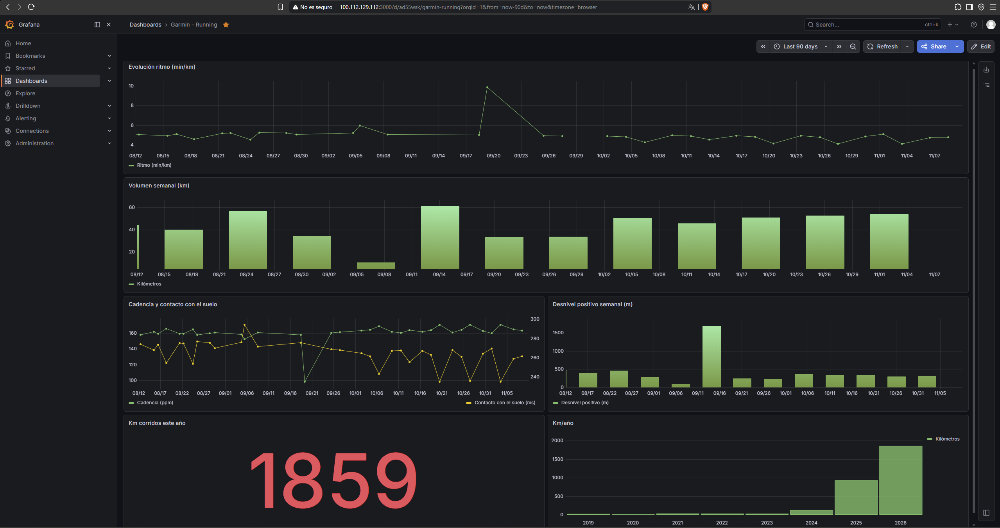
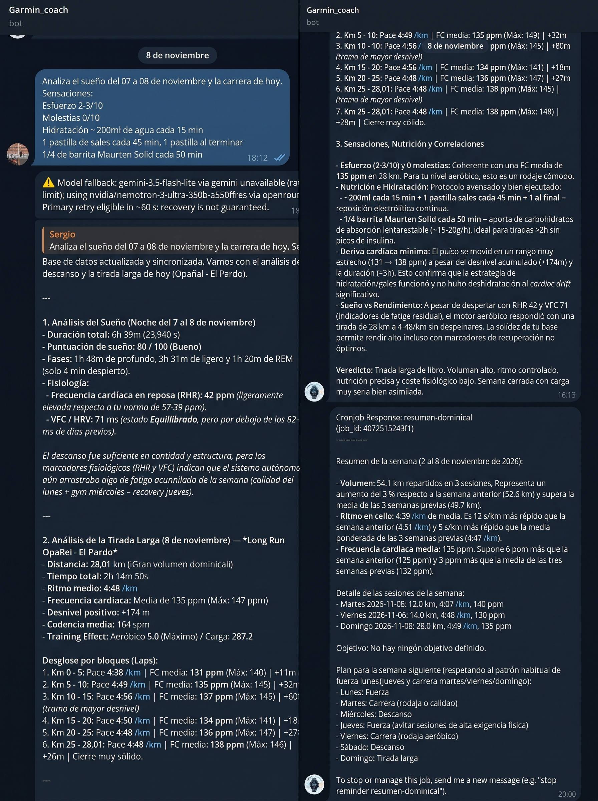

# Garmin Analytics + Hermes Coach

Proyecto alojado en Docker a través de una Raspberry Pi5 que descarga el historial de entrenamiento y sueño de Garmin Connect, lo almacena en una base de datos con SQLite, desde la base de datos se visualiza en Grafana y también se le da acceso al historial de entrenamientos y sueño a un agente de IA mediante [Hermes Agent](https://github.com/NousResearch/hermes-agent) para realizar funciones de coaching, análisis de métricas y elaboración de un resumen semanal automático


> [!note]
> **Introducción de API keys:**
> Las credenciales de terceros (Gemini, OpenRouter, bot de Telegram) se introducen de forma interactiva **dentro del contenedor ya desplegado**, no como variables de entorno en texto plano en ningún archivo versionado.

## Arquitectura

```
Garmin Connect (API no oficial)          Apple Health (export XML, una vez — opcional)
        │                                           │
        ▼                                           ▼
  sync.py (Docker, 1 vez/día)           importar_apple.py (una vez)
        │                                           │
        └───────────────────┬───────────────────────┘
                             ▼
                    garmin.db (SQLite)
                   activities · activity_laps · daily_wellness
                             │
              ┌──────────────┴──────────────┐
              ▼                              ▼
          Grafana                      Hermes Agent
   (dashboards, :ro)              (Telegram, :ro + skills)
                                          │
                                   Gemini API (gratis)
                                   + fallback OpenRouter
```

## Requisitos

- Host con Docker.
- [Portainer](https://www.portainer.io/) o `docker compose`.
- Cuenta de Garmin Connect.
- *(Opcional)* Datos exportados de Apple Health, en caso de haberlo usado un Apple Watch para entrenar.
- Proveedor de IA para Hermes.
- Bot de Telegram creado vía [@BotFather](https://t.me/BotFather).



